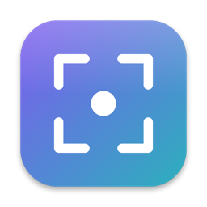

<div align="center">



# 📸 Snapix

**A menu-bar screenshot, annotation and OCR tool for macOS.**


[](https://www.swift.org/)
[](https://www.apple.com/macos/)
[](https://developer.apple.com/xcode/swiftui/)
[](https://github.com/Arrows78/Snapix/actions/workflows/ci.yml)

</div>

**Snapix** captures your screen, lets you annotate and polish the result, and reads the text out of it. It lives in the menu bar and answers to global hotkeys: area, window, fullscreen and scrolling captures, an editor with arrows, blur, spotlight, counters and a backdrop, OCR and QR codes, a colour picker and a contrast checker, pinned screenshots and a library of everything you captured.

> [!NOTE]
> Snapix runs entirely on your Mac: no account, no analytics. The only network call is the optional upload to an HTTP endpoint **you** configure.

## ✨ Features

### 📷 Capture

Menu-bar icon and global hotkeys, rebindable in **Preferences › Shortcuts**.

- **Area**: frozen screen, pixel loupe, live W×H.
- **Fullscreen**, **any window** (hover to pick), **active window**, **delayed (3–15 s)**, **repeat last area**.
- **Scrolling capture**: automatic down or up (synthetic scroll and frame stitching), or manual (scroll either way, press Done).
- **Adjustable selection** (optional): handles, move by dragging or holding Space, arrow-key nudge, Return or double-click to capture.
- **Screen recording**: select an area and record it to **MP4** (optional system audio, cursor on or off) or an animated **GIF**. A red frame and a small timer pill show what is recorded; press the shortcut again or click Stop. The file lands in your screenshots folder and on the clipboard.
- **Open an image** from the clipboard or a file.

### ✏️ Editor

- **Tools**, one key each: select `V`, arrow `A` (3 styles, curvable), rectangle `R`, oval `O`, line `L`, freehand `P`, text `T` (optional background), highlighter `H`, blur / erase `B` (pixelate, gaussian, erase), spotlight `S`, counter `C`, ruler `M`, magnifier `G`, image overlay `I`, crop `X`.
- **Editing**: select, move and resize shapes, Delete, arrow-key nudge, Shift to constrain, unlimited undo / redo, zoom and pinch, colour under the cursor.
- **Style presets** (More menu): four built-in looks plus your own, saved by name; applying one restyles the selected shape too.
- **Backdrop** (`K`): padding, inner and outer radius, shadow, gradient or solid, angle, presets, randomize.
- **Snapping**: edge snapping for boxes and crop (hold ⌥ to bypass), and *Snap to Similar Region* (right-click a shape).
- **Image**: resize, crop (Return to apply) with Uncrop, merge annotations into the image, print, drag the result out of the editor into other apps.
- **Image overlay**: lay a clipboard image over the screenshot, drag to align, a slider sets the opacity.
- **Hide sensitive data** (More menu): finds emails, card numbers, IBANs, phone numbers, API tokens and IP addresses with on-device OCR and pixelates each one.
- **Remove background**: isolates the main subject on a transparent background (on-device), in the editor or straight from a capture; combine it with the backdrop.
- **Library**: every capture is kept (last 200, optionally deleted after 7, 30 or 90 days). Click thumbnails to select them, then reopen, copy, pin, delete, or combine them vertically or horizontally into one image.

### 🔎 Analysis

- **OCR and QR / barcodes** (Vision) from a dragged area or the editor, with an optional *remove line breaks*.
- **Colour picker**: HEX, RGB, CSS, HSL, Swift and C# output.
- **Contrast checker**: WCAG ratio and APCA Lc. Pick two colours, or analyse a region in the editor.

### 📤 Output

- **Copy**, **save** (PNG, JPEG, or automatic by content), **save as**, downscale Retina, filename template, **upload** to your own HTTP endpoint.
- **Pin to screen**: drag, scroll to resize, ⌥-scroll for opacity, double-click to edit, right-click menu.
- **After-capture actions**, Esc to copy or save, launch at login, optional shutter sound.
- **Shortcuts cheat sheet** and **settings backup**: list every shortcut in one floating sheet; export or import preferences (never the upload credential) from **Preferences › Backup**.
- **Languages**: English and French, following macOS.

## ⌨️ Default shortcuts

| Shortcut | Action |
| --- | --- |
| `⇧⌘1` | Fullscreen screenshot |
| `⇧⌘2` | Area capture |
| `⇧⌘7` | Capture any window |
| `⇧⌘8` | Recognize text / QR code |
| `⇧⌘9` | Scrolling capture |
| `⇧⌘0` | Delayed screenshot |

The other actions (active window, repeat last area, scrolling upwards or manually, colour picker, contrast checker, open from clipboard, Library) have no default shortcut: assign one in **Preferences › Shortcuts**, or call them from the URL scheme below. Turn off the macOS screenshot shortcuts in **System Settings › Keyboard › Keyboard Shortcuts › Screenshots** if they clash.

### 🔗 URL scheme

`snapix://area`, `fullscreen`, `window`, `active-window`, `delayed`, `repeat`, `scrolling`, `scrolling-up`, `scrolling-manual`, `library`, `shortcuts`, `ocr`, `cutout`, `record`, `record-gif`, `pick-color`, `contrast`, `clipboard`, with an optional `?then=copy,save,edit,pin`.

```bash
open "snapix://area?then=copy"
```

## 🔐 Permissions

| Permission | Used by | Why |
| --- | --- | --- |
| Screen Recording | Every capture | Read the pixels of the screen. |
| Accessibility | Automatic scrolling capture | Send the synthetic scroll events. |

## 🧱 Technology stack

| Area | Technologies |
| --- | --- |
| Language | Swift (Swift Package, no Xcode project) |
| User interface | AppKit (menu bar, panels, overlays, canvas), SwiftUI (preferences, options) |
| Capture | ScreenCaptureKit |
| Recognition | Vision (text, QR codes and barcodes) |
| Persistence | `UserDefaults` for settings, PNG files for the Library |
| Testing | Built-in non-interactive self-test (`--selftest`) |

## 📦 Installation

### Homebrew

```bash
brew install arrows78/snapix/snapix
```

Use the full name: Homebrew 7 only loads casks from third-party taps you trust, and naming the tap in the command trusts that cask. If you ran `brew tap arrows78/snapix` first, run `brew trust --tap arrows78/snapix` before installing. Update with `brew upgrade --cask snapix`; `brew uninstall --zap --cask snapix` also removes its settings. The tap is [`Arrows78/homebrew-snapix`](https://github.com/Arrows78/homebrew-snapix).

### Download

Grab `Snapix-<version>.zip` from the [latest release](https://github.com/Arrows78/Snapix/releases/latest), unzip it and move **Snapix.app** to `/Applications`. Releases are universal (Apple Silicon and Intel) and need macOS 14 or later.

> [!WARNING]
> Releases are signed ad hoc, not notarised, so macOS blocks the first launch. Open **System Settings › Privacy & Security** and click **Open Anyway**, or run `xattr -dr com.apple.quarantine /Applications/Snapix.app`.

On first launch, grant **Screen Recording** (and **Accessibility** for automatic scrolling capture) in System Settings.

### Build from source

You need macOS 14 or later and [Xcode](https://developer.apple.com/xcode/) with its command-line tools.

```bash
git clone git@github.com:Arrows78/Snapix.git
cd Snapix
./build.sh        # -> build/Snapix.app
open build/Snapix.app
```

Or build and install into `/Applications` in one go (quits the running copy and relaunches; `--no-launch` to skip the relaunch):

```bash
./install.sh
```

> [!TIP]
> `build.sh` signs with a local identity named `Snapix Local Signing` when your keychain has one, and falls back to an ad-hoc signature otherwise. An ad-hoc signature changes on every build, so macOS asks for the permissions again after each rebuild. Create a self-signed code-signing certificate with that name (or set `SNAPIX_SIGN_IDENTITY`) to keep them.

## 🛠️ Scripts

| Command | Description |
| --- | --- |
| `./build.sh` | Builds `build/Snapix.app`. `SNAPIX_UNIVERSAL=1` builds for Apple Silicon and Intel. |
| `./install.sh` | Builds, installs into `/Applications` and relaunches. |
| `./scripts/ci.sh` | Runs the release tool tests, the release files check, the build and the self-test: the same checks as CI. |
| `build/Snapix.app/Contents/MacOS/Snapix --selftest <dir>` | Non-interactive checks (stitching, rendering, snapping, preview placement, curved arrows, contrast, formats, undo), writing sample images to `<dir>`. |
| `swift Resources/make_icon.swift <out.png>` | Renders the 1024 px app icon. |
| `scripts/render_cask.sh VERSION SHA256` | Prints the Homebrew cask of a release (used by the release workflow). |
| `python3 scripts/release.py prepare` | Next version, version bump and changelog from the commit messages ([`docs/RELEASING.md`](docs/RELEASING.md)). |

To publish a release (details in [`docs/RELEASING.md`](docs/RELEASING.md)):

1. `python3 scripts/release.py prepare` picks the next version from the commit messages (Conventional Commits), bumps `Resources/Info.plist` and rewrites `CHANGELOG.md`. Add `--dry-run` to preview it.
2. Commit it (`chore(release): X.Y.Z`) and push the matching tag: the [release workflow](.github/workflows/release.yml) builds a universal app and publishes it as a GitHub release (pre-release for `0.x`), with `docs/releases/<version>.md` as notes when that file exists.

## 📂 Project structure

```text
Snapix/
├── Package.swift          # Swift Package, one executable target
├── build.sh               # Builds and signs build/Snapix.app
├── install.sh             # Builds, installs into /Applications, relaunches
├── Resources/             # Info.plist, app icon and its generator, fr.lproj
├── Sources/Snapix/
│   ├── main.swift, AppDelegate.swift   # Entry point, menu bar, URL scheme
│   ├── Capture, ScrollCapture, Recorder, SelectionOverlay, PreviewPanel
│   ├── EditorWindow, EditorChrome, CanvasView, OptionsPanel, BackdropPanel
│   ├── Model, StylePreset, Renderer, Exporter, ImageDrag    # Annotations, drawing, output
│   ├── OCR, Redaction, Cutout, ColorTools      # Vision, sensitive data, background removal, colour
│   ├── History, Combine, PinWindow, HomeWindow # Library, stitching images, pins, home
│   ├── Toast, Feedback, ShortcutSheet          # Feedback, shutter sound, cheat sheet
│   ├── Settings, Preferences, HotKey, L10n     # Preferences, shortcuts, localisation
│   └── SelfTest.swift                          # Behind --selftest
├── scripts/               # CI, release tool and its tests
├── packaging/homebrew/    # Cask template for the Homebrew tap
├── docs/                  # Releasing guide, release notes
└── .github/workflows/     # CI and release
```

## 💾 Local data

| What | Where |
| --- | --- |
| Settings and shortcuts | `UserDefaults` (bundle identifier `com.labs.snapix`) |
| Library | `~/Library/Application Support/Snapix/History`, last 200 captures |
| Saved screenshots | `~/Pictures/Snapix` by default, configurable in Preferences |

## 🙌 Contributing

Issues and pull requests are welcome.

1. Fork the repository and create a branch.
2. Make your change; extend the self-test in `Sources/Snapix/SelfTest.swift` when it is testable without a screen.
3. Run the checks:

   ```bash
   ./scripts/ci.sh
   ```

4. Commit using [Conventional Commits](https://www.conventionalcommits.org/): the type decides the version bump and the changelog entry ([`docs/RELEASING.md`](docs/RELEASING.md)), and CI checks it on pull requests.
5. Push the branch and open a pull request. Keep pull requests focused and describe user-facing behaviour changes.

See the [changelog](CHANGELOG.md) for what changed in each version.
